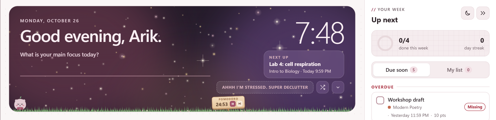
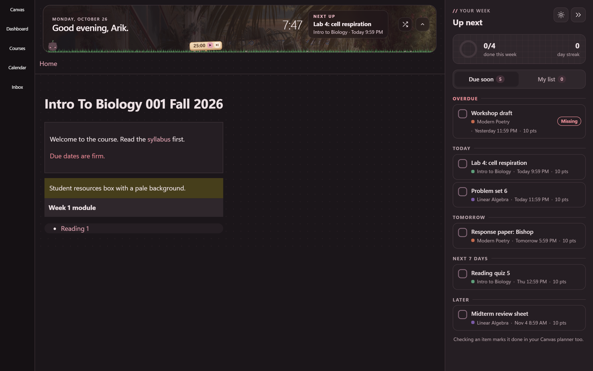

# blush manual

everything blush for canvas does, and where to find it. if you haven't installed it yet, start with the [quickstart](README.md#quickstart).

most settings live in the popup. click the blush icon in chrome's toolbar to open it, and every change saves right away.

- [the banner](#the-banner)
- [the to-do column](#the-to-do-column)
- [quick jump and shortcuts](#quick-jump-and-shortcuts)
- [super declutter](#super-declutter)
- [the study buddy](#the-study-buddy)
- [your look](#your-look)
- [you](#you)
- [speed and focus](#speed-and-focus)
- [your school's own address](#your-schools-own-address)
- [updating without losing your garden](#updating-without-losing-your-garden)
- [when something looks off](#when-something-looks-off)

## the banner

the banner sits above every canvas page. on the dashboard it's full size, and on other pages it shrinks to a slim strip. the arrow button on the right switches between the two.

- **greeting and clock.** the greeting uses your canvas name, or the name you set in the popup under **you**.
- **today's focus.** on the dashboard, type what you want to get done and press enter. it turns into a checkbox you can tick off.
- **next up.** your nearest due item. click it to open the assignment.
- **the picture.** a public domain painting from the art institute of chicago, a new one each day. the shuffle button swaps it, and the name of the painting links to it. under **banner** in the popup you can pick paintings, your own photos, both, or stars.

drag a picture from your computer onto the banner to add it to your photos.

### making your own banner art

make it 2560 x 640 px (4:1). for a retina or 4k screen, go up to 3456 x 864 px. the picture fills the banner like a cover photo, so the edges can get trimmed. keep the important part in the middle band. the left third sits behind the greeting under a soft fade, so the right two thirds show the most.

measured sizes of the full banner on the dashboard:

| screen | to-do column open | to-do column closed |
| --- | --- | --- |
| 1920 x 1080 | about 1430 x 290 | about 1730 x 290 |
| 1536 x 864 | about 1045 x 290 | about 1345 x 290 |
| 1440 x 900 | about 950 x 290 | about 1250 x 290 |
| 1366 x 768 | about 875 x 290 | about 1175 x 290 |

the slim banner on course pages is about 1735 x 135 on a 1920 x 1080 screen.

## the to-do column

the column on the right shows your week. canvas shrinks to make room for it, and on the dashboard it replaces canvas's own to-do sidebar. press `t` or the `»` button to fold it into a slim rail, and `t` again to open it.

- **due soon** groups everything from your canvas planner into overdue, today, tomorrow, the next 7 days and later. checking an item marks it done in your real canvas planner too. submitted work shows a submitted tag, and missing work shows a missing tag.
- **my list** is your own to-do list for anything canvas doesn't know about. it stays in chrome on your computer.
- **the ring** shows how much of this week's work is done, next to your day streak. you keep the streak by checking off at least one thing a day.
- **cheers.** checking something off pops up a small note like "Progress, logged." you can turn these off under **speed and focus**.

the column loads from a saved copy first, so it shows up right away and then refreshes from canvas.

## quick jump and shortcuts

press `ctrl+k` (`cmd+k` on a mac) or `/` on any canvas page. type part of a course name, a section, an assignment, or a page you opened recently, then press enter. `ctrl+enter` opens it in a new tab. try "bio grades" to jump straight to the grades of a biology course.

the highlighted result starts loading while you look at it, so enter usually lands right away.

press `?` for the full list:

| key | where it goes |
| --- | --- |
| `ctrl+k` or `/` | quick jump |
| `t` | open or close the to-do column |
| `p` | start or pause the study timer |
| `1` to `9` | your 1st to 9th course |
| `g` then `d` | dashboard |
| `g` then `k` | calendar |
| `g` then `i` | inbox |
| `g` then `shift+g` | all grades |
| `?` | the shortcut list |

inside a course:

| key | where it goes |
| --- | --- |
| `g` then `h` | course home |
| `g` then `a` | assignments |
| `g` then `m` | modules |
| `g` then `g` | grades |
| `g` then `s` | syllabus |
| `g` then `n` | announcements |
| `g` then `x` | discussions |
| `g` then `f` | files |
| `g` then `p` | pages |

single-key shortcuts pause while you type, and you can turn them off under **speed and focus**.

## super declutter

for nights when the whole dashboard is too much. tap **AHHH I'M STRESSED. SUPER DECLUTTER** on the banner or at the top of the popup. blush hides everything except what's due before midnight tonight and isn't submitted yet, soonest first, with how long you have left.

- checking an item marks it done in your canvas planner and crosses it off.
- when nothing is due tonight, it says so and shows the next thing coming up.
- your buddy holds a YOU GOT THIS!!! sign. tap the sign or your buddy for a secret quote.
- it stays on, even after a refresh, until you tap **I feel better. Bring my dashboard back.** clicking an assignment still opens it normally.

the button on the banner shows on the dashboard and hides when the window is narrower than 900 px. the one in the popup works from any page, and the calm screen shows up once you're back on the dashboard.

## the study buddy

a pomodoro timer with a little pet and a garden along the bottom of the banner.

- **the timer** lives on the tiny pomodoro sign in the grass. press play, or `p` anywhere on canvas. focus sessions are 15, 25 or 50 minutes (pick under **study buddy** in the popup). breaks start on their own, 5 minutes after a short session, 10 after a 50, and 15 after every fourth.
- **the timer keeps going** across pages and tabs, and chrome sends a notification when a session ends.
- **the garden** grows one plant for every 25 focused minutes, and your buddy levels up as it grows. hover the sign to see the count.
- **your buddy** walks back and forth through the grass, stops to read while you focus, and hops when a plant grows. tap it to make it stop and stay put, and tap again to let it wander. it only talks when you tap it.

under **study buddy** in the popup you can pick from seven buddies (mochi, a bunny, a kitty, a frog, a duckling, a bear cub and a penguin), rename yours, turn walking off with **walks around**, change the focus length, or restart the timer.

### drawing your own buddy

- draw a PNG with a transparent background, 256 x 256 px.
- face right (blush flips it when it walks left), centered, with the feet on the green line near the bottom.
- the poses are standing (the only one you need), a walking step (makes it waddle), studying (while you focus) and happy (on breaks and when a plant grows).

the `templates/` folder has two files to draw on, and the popup has a link to download the sheet. `pet-template-256.png` is one 256 px box. `pet-template-sheet.png` has all four poses side by side, with guide lines and a faint mochi to trace. draw on a new layer, hide the guide layer, and export only your drawing as a transparent PNG.

upload single poses into their slots under **study buddy > or draw your own**, or upload the whole sheet with **upload the whole sheet**. blush cuts out each pose and skips empty boxes. your buddy switches to your drawing and shows up as "yours" in the picker.

## your look

### theme

auto follows your computer's light or dark setting. light and dark stay put. the moon and sun button on the to-do column switches it too.

### colors

turn on **use my colors** to swap dusty pink for your own palette.

- start from a preset: blush, sage, lavender, ocean, cocoa or night.
- or upload a palette. it takes a palette picture, a coolors link, `.ase` and `.gpl` files, or any file with hex codes in it. you can also paste hex codes or a coolors link.
- tap a role (accent, background, cards, text, sidebar), then a swatch to fill it. **auto-pick light** and **auto-pick dark** build a full theme from the palette for you.
- blush warns you when text gets hard to read on your background.

### fonts

paste a google fonts link, or just the font's name, for body text and headings. the popup links to google fonts so you can browse.

### handwriting

one button switches all of canvas to **arik hand**, a handwriting font that comes with blush. it sets the type a little bigger so it stays easy to read.

### photos

- **page background.** add a photo under **photos**, and use the slider to soften it so text stays readable.
- **course cards.** on the dashboard, hover a card and tap the camera, or drop a picture right on the card.
- **banner.** see [the banner](#the-banner).

## you

- **your name** is the name in the greeting.
- **your greetings.** write your own greeting for morning, afternoon, evening and late night, like "Lock in, {name}!". `{name}` turns into your name, and a box you leave empty keeps the normal greeting.
- **your quotes.** type your own motivational quotes, one per line, up to 100. your buddy says them when you tap it, on the banner and on super declutter. they come up twice as often as the built-in ones, or turn on **only my quotes** to hear just yours.

## speed and focus

| switch | what it does |
| --- | --- |
| calm mode | turns off canvas's own animations |
| declutter | hides the footer, card images and the duplicate to-do list |
| instant navigation | preloads links you hover so they open right away |
| single-key shortcuts | the one-letter shortcuts above. `ctrl+k` always works |
| cheers | the little notes when you finish something |

instant navigation skips module items, since opening one can tick off a "view this page" requirement. discussions, announcements, quizzes and the inbox are downloaded ahead but never opened early, because opening them marks things as read. if canvas ever counts a view you didn't make, turn instant navigation off.

## your school's own address

blush runs on any school at `*.instructure.com` by itself. if your school's canvas has its own address, like `canvas.yourschool.edu`:

1. open your school's canvas.
2. click the blush icon. the popup shows a **your school** box.
3. tap **turn on blush for** your school's address, and allow it when chrome asks.

the page reloads with blush on. you only do this once per address. to turn it off again, remove the site under **details > site access** on the blush card in `chrome://extensions`.

## updating without losing your garden

replace the files in the same folder, then click the reload arrow on the blush card in `chrome://extensions`.

chrome treats an unpacked extension in a different folder as a different extension. if you unzip an update into a new folder and load that one, your garden, streak, photos and settings start over.

## when something looks off

- **parts of a page stay light in dark mode.** pages built with canvas's newer components, and tools embedded from other sites, can stay partly light. the text editor you type assignments into also stays light, because it runs in a separate frame.
- **the stressed button is missing.** it only shows on the dashboard banner, and it hides when the window is narrower than 900 px. the button at the top of the popup always works.
- **your buddy stands still.** check that **walks around** is on under **study buddy**.
- **a font won't load.** the box under the font field says why. check the spelling against google fonts.
- **nothing changed after an update.** click the reload arrow on the blush card, then refresh canvas.
