# blush manual

everything blush for canvas does, and where to find it. if you haven't installed it yet, start with the [quickstart](README.md#quickstart).

most settings live in the popup. click the blush icon in chrome's toolbar to open it, and every change saves right away. the everyday switches come first, and the deeper ones (making your own palette, drawing your own buddy) are folded away until you open them. the bottom of the popup links back to this manual and shows which version you have.

- [the banner](#the-banner)
- [the to-do column](#the-to-do-column)
- [clean up canvas](#clean-up-canvas)
- [quick jump and shortcuts](#quick-jump-and-shortcuts)
- [super declutter](#super-declutter)
- [the study buddy](#the-study-buddy)
- [your look](#your-look)
- [you](#you)
- [speed](#speed)
- [your school's own address](#your-schools-own-address)
- [updating without losing your garden](#updating-without-losing-your-garden)
- [when something looks off](#when-something-looks-off)

## the banner

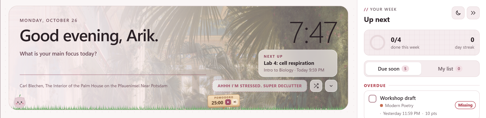

the banner sits above every canvas page. on the dashboard it's full size, and on other pages it shrinks to a slim strip. the arrow button on the right switches between the two.

- **greeting and clock.** the greeting uses your canvas name, or the name you set in the popup under **you**.
- **today's focus.** on the dashboard, type one thing you want to get done and press enter. it turns into a checkbox you can tick off.
- **next up.** your nearest due item, with how long you have left when it's due within a day, like "9:59 PM · in 1h 15m". click it to open the assignment. when something is overdue, a small **+1 overdue** line under it opens the to-do column at the overdue group.
- **the picture.** a public domain painting from the art institute of chicago, a new one each day. the shuffle button swaps it, and the name of the painting links to it. under **banner** in the popup you can pick paintings, your own photos, both, or stars.

drag a picture from your computer onto the banner to add it to your photos.

### making your own banner art

make it 2560 x 640 px (4:1). for a retina or 4k screen, go up to 3456 x 864 px. the picture fills the banner like a cover photo, so the edges can get trimmed. keep the important part in the middle band. the left third sits behind the greeting under a soft fade, so the right two thirds show the most.

measured sizes of the full banner on the dashboard:

| screen | to-do column open | to-do column closed |
| --- | --- | --- |
| 1920 x 1080 | about 1430 x 290 | about 1730 x 290 |
| 1536 x 864 | about 1045 x 290 | about 1345 x 290 |
| 1440 x 900 | about 950 x 290 | about 1250 x 290 |
| 1366 x 768 | about 875 x 290 | about 1175 x 290 |

the slim banner on course pages is about 1735 x 135 on a 1920 x 1080 screen.

## the to-do column

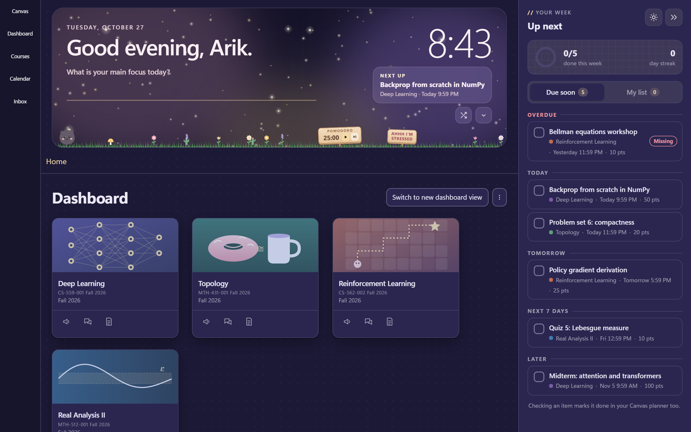

the column on the right shows your week. canvas shrinks to make room for it, and on the dashboard it replaces canvas's own to-do sidebar. press `t` or the `»` button to fold it into a slim rail, and `t` again to open it.

- **due soon** groups everything from your canvas planner into overdue, today, tomorrow, the next 7 days and later, with a count on each, like "TODAY · 2". a group worth 100 points or more shows its total too.
- **each item** shows when it's due first. under today and tomorrow that's just the time, plus "in 1h 15m" in bold when it's due within a day. overdue items say how late they are, like "1 day late". the course and points sit on the line below, and submitted or missing tags sit next to the time.
- **checking an item** marks it done in your real canvas planner too.
- **overdue** shows the 3 most recent items, with missing ones first. **show 4 more overdue** opens the rest.
- **my list** is your own to-do list for anything canvas doesn't know about. it stays in chrome on your computer.
- **the ring** shows how much of this week's work is done, next to your day streak. you keep the streak by checking off at least one thing a day.
- **cheers.** checking something off pops up a small note like "Progress, logged." you can turn these off under **speed**.
- **celebrations.** checking something off also sets off a little celebration from the checkbox. pick one under **celebrations** in the popup:
  - **match** picks petals for blush, leaves for sage, confetti for lavender, bubbles for ocean, candy sprinkles for cocoa and stardust for night and night sky. your own palette gets confetti in its colors.
  - **confetti**, **stardust** (gold stars, a shooting star and glitter), **petals**, **leaves**, **bubbles** and **sprinkles** always use that one.
  - **stickers** slaps a sticker like "nice!" or a gold star onto the row, and it stays there while the item is checked.
  - **off** turns them off. the cheers notes still show.

  when the last thing due this week gets checked off, the whole screen celebrates: confetti cannons, a meteor shower, a petal shower, a wave of bubbles, or a big "week done!" sticker. if your computer is set to reduce motion, nothing flies and the checkbox glows softly instead.

the column shows a saved copy right away, then checks canvas again, so something you just submitted shows up as submitted. the line at the bottom says when it last updated, and the refresh button next to it checks again. if canvas can't be reached it says so and shows the time of the list you're looking at.

the first time you open canvas with blush, a small card at the top of the column shows the main keys. tap **got it** and it doesn't come back.

## clean up canvas

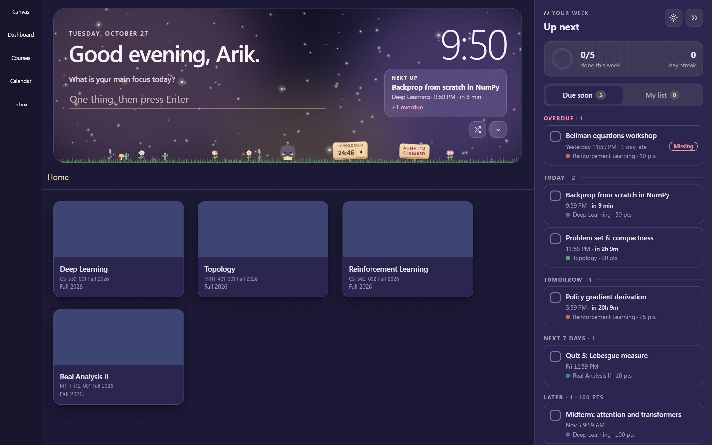

under **clean up canvas** in the popup, four switches tidy up canvas itself:

- **hide canvas extras** hides the footer, the canvas logo and canvas's own to-do list.
- **hide the dashboard header** hides the dashboard title, the switch to new dashboard view button and its menu.
- **hide course images** shows every card with its plain color instead of the course picture. photos you added to a card yourself still show.
- **hide card icons** hides the row of announcements, discussions and assignments icons under each card.

## quick jump and shortcuts

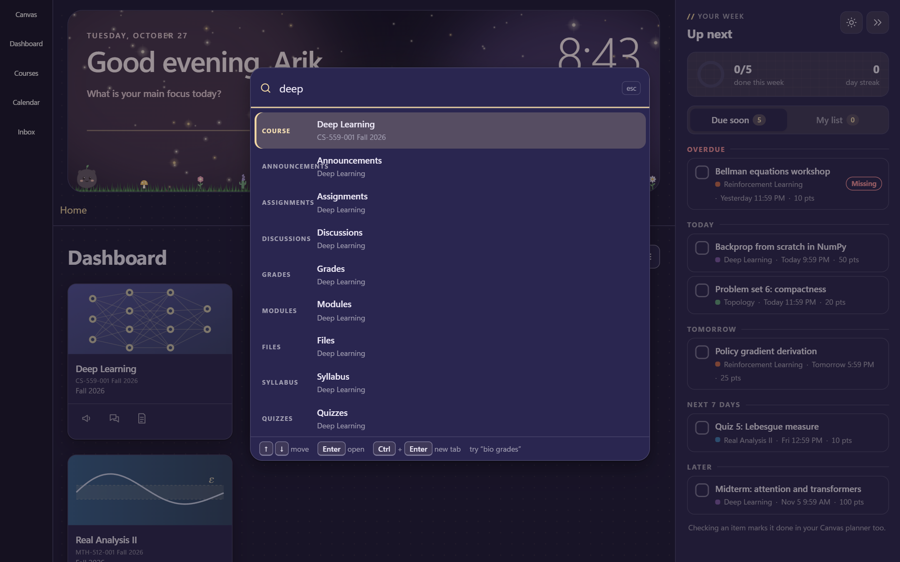

press `ctrl+k` (`cmd+k` on a mac) or `/` on any canvas page. type part of a course name, a section, an assignment, or a page you opened recently, then press enter. `ctrl+enter` opens it in a new tab.

type a course's name and its open assignments come right after it, marked **due** with how long you have left. a few of its sections follow. name the section too, like "bio grades", to jump straight there.

when the highlighted result is a course page or a section, it starts loading while you look at it, so enter usually lands right away.

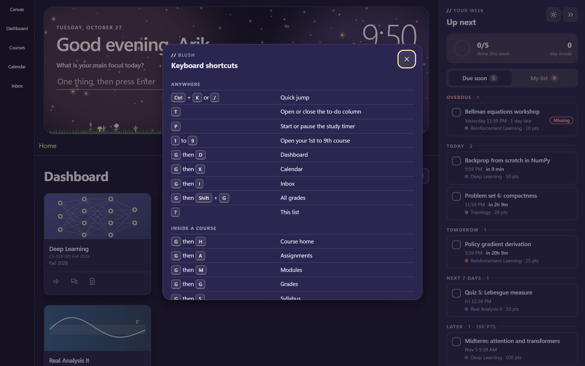

press `?` for the full list:

| key | where it goes |
| --- | --- |
| `ctrl+k` or `/` | quick jump |
| `t` | open or close the to-do column |
| `p` | start or pause the study timer |
| `1` to `9` | your 1st to 9th course |
| `g` then `d` | dashboard |
| `g` then `k` | calendar |
| `g` then `i` | inbox |
| `g` then `shift+g` | all grades |
| `?` | the shortcut list |

inside a course:

| key | where it goes |
| --- | --- |
| `g` then `h` | course home |
| `g` then `a` | assignments |
| `g` then `m` | modules |
| `g` then `g` | grades |
| `g` then `s` | syllabus |
| `g` then `n` | announcements |
| `g` then `x` | discussions |
| `g` then `f` | files |
| `g` then `p` | pages |

single-key shortcuts pause while you type, and you can turn them off under **speed**. hover any of blush's icon buttons to see what it does and its key.

## super declutter

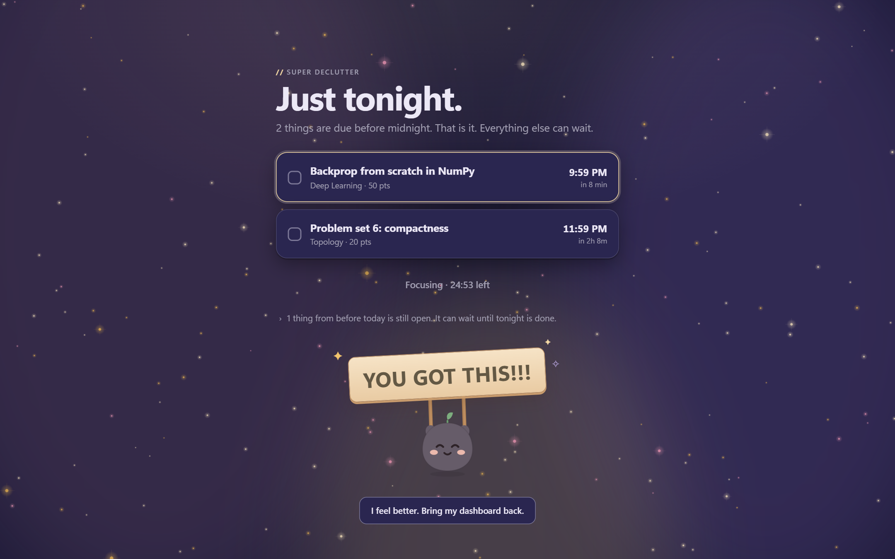

for nights when the whole dashboard is too much. tap **AHHH I'M STRESSED. SUPER DECLUTTER** on the banner or at the top of the popup. blush hides everything except what's due before midnight tonight and isn't submitted yet, soonest first, with how long you have left.

- checking an item marks it done in your canvas planner and crosses it off.
- when nothing is due tonight, it says so and shows the next thing coming up.
- your buddy holds a YOU GOT THIS!!! sign. tap the sign or your buddy for a secret quote.
- **start a focus** with the button under the list. it starts the study timer with your buddy, and while it runs the button turns into a countdown.
- if something from before today is still open, one quiet line says so. tap it to see those items. they can wait until tonight is done.
- it stays on, even after a refresh, until you tap **I feel better. Bring my dashboard back.** clicking an assignment still opens it normally.
- it turns itself off the next morning after 5 am, with a little "Morning. Your dashboard is back."

the button on the banner shows on the dashboard and hides when the window is narrower than 900 px. turn on **stressed sign in the grass** under **banner** to move it onto a little wooden sign next to the pomodoro sign instead. the button in the popup takes your canvas tab to the dashboard. from a page that isn't canvas, it opens the next time you visit your dashboard.

## the study buddy

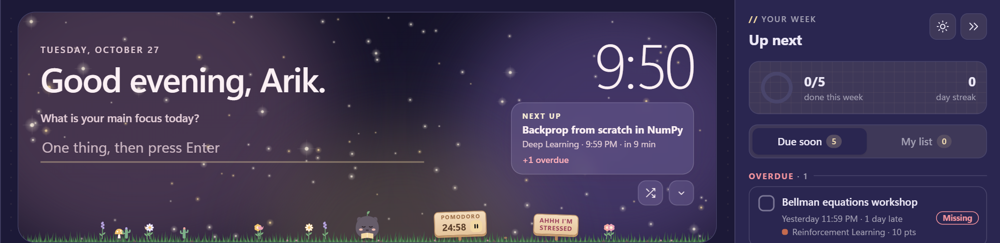

a pomodoro timer with a little pet and a garden along the bottom of the banner.

- **the timer** lives on the tiny pomodoro sign in the grass. press play, or `p` anywhere on canvas. while you focus the sign only shows pause, so a slip can't skip your session. skip shows up when you pause or take a break. focus sessions are 15, 25 or 50 minutes (pick under **study buddy** in the popup). breaks start on their own, 5 minutes after a short session, 10 after a 50, and 15 after every fourth.
- **the timer keeps going** across pages and tabs, and chrome sends a notification when a session ends.
- **the garden** grows one plant for every 25 focused minutes, and your buddy levels up as it grows. hover the sign to see the count.
- **your buddy** walks back and forth through the grass, stops to read while you focus, and hops when a plant grows. tap it to make it stop and stay put, and tap again to let it wander. it only talks when you tap it. if your computer is set to reduce motion, your buddy stays put unless you turn **walks around** on.

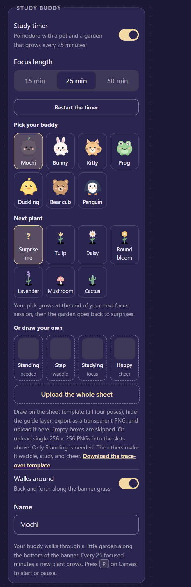

under **study buddy** in the popup you can pick from seven buddies (mochi, a bunny, a kitty, a frog, a duckling, a bear cub and a penguin), rename yours, turn walking off with **walks around**, change the focus length, or restart the timer.

**next plant** picks what grows at the end of your next focus session: tulip, daisy, round bloom, lavender, mushroom or cactus. after that one grows, the garden goes back to surprising you. **surprise me** clears your pick.

### drawing your own buddy

- draw a PNG with a transparent background, 256 x 256 px.
- face right (blush flips it when it walks left), centered, with the feet on the green line near the bottom.
- the poses are standing (the only one you need), a walking step (makes it waddle), studying (while you focus) and happy (on breaks and when a plant grows).

the `templates/` folder has two files to draw on, and the popup has a link to download the sheet. `pet-template-256.png` is one 256 px box. `pet-template-sheet.png` has all four poses side by side, with guide lines and a faint mochi to trace. draw on a new layer, hide the guide layer, and export only your drawing as a transparent PNG.

open **draw your own buddy** under **study buddy** in the popup. upload single poses into their slots, or upload the whole sheet with **upload the whole sheet**. blush cuts out each pose and skips empty boxes. your buddy switches to your drawing and shows up as "yours" in the picker.

## your look

### theme

auto follows your computer's light or dark setting. light and dark stay put. the moon and sun button on the to-do column switches it too.

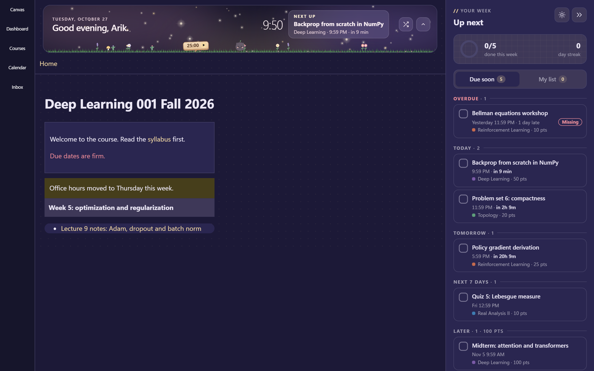

### colors

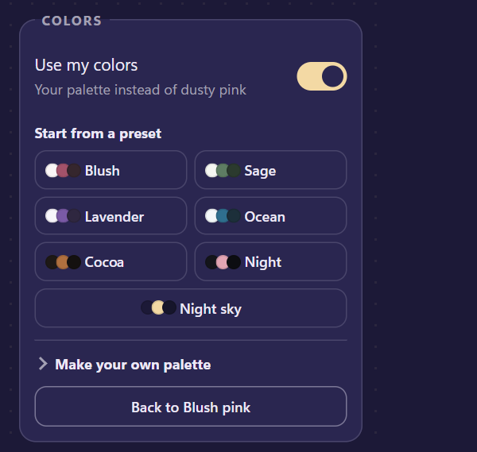

turn on **use my colors** to swap dusty pink for your own palette.

- start from a preset: blush, sage, lavender, ocean, cocoa, night or night sky. night sky also switches the banner to the stars.
- or upload a palette. it takes a palette picture, a coolors link, `.ase` and `.gpl` files, or any file with hex codes in it. you can also paste hex codes or a coolors link.
- open **make your own palette** to upload or paste one, then tap a role (accent, background, cards, text, sidebar) and a swatch to fill it. **auto-pick light** and **auto-pick dark** build a full theme from the palette for you.
- blush warns you when text gets hard to read on your background.

### fonts

paste a google fonts link, or just the font's name, for body text and headings. the popup links to google fonts so you can browse.

### text size

the **text size** slider, from 85% to 130%, makes everything on your canvas pages bigger or smaller, blush included. it works like chrome's zoom, but only on canvas.

### handwriting

one button switches all of canvas to **arik hand**, a handwriting font that comes with blush. it sets the type a little bigger so it stays easy to read.

### photos

- **page background.** add a photo under **photos**, and use the slider to soften it so text stays readable.
- **course cards.** on the dashboard, hover a card and tap the camera, or drop a picture right on the card.
- **banner.** see [the banner](#the-banner).

## you

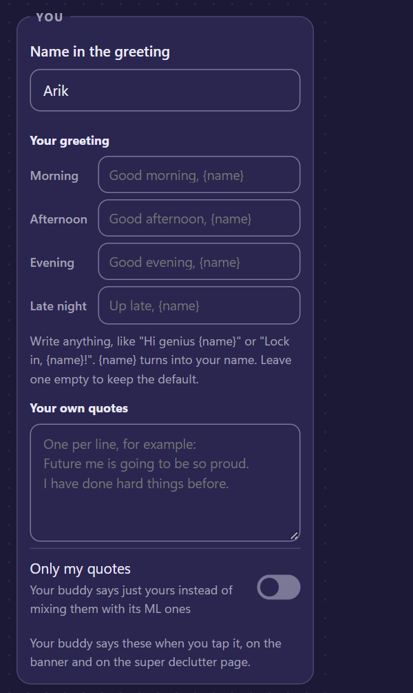

- **your name** is the name in the greeting.
- **your greetings.** write your own greeting for morning, afternoon, evening and late night, like "Lock in, {name}!". `{name}` turns into your name, and a box you leave empty keeps the normal greeting.
- **your quotes.** type your own motivational quotes, one per line, up to 100. your buddy says them when you tap it, on the banner and on super declutter. they come up twice as often as the built-in ones, or turn on **only my quotes** to hear just yours.

## speed

| switch | what it does |
| --- | --- |
| turn off canvas animations | menus and trays open right away without sliding or fading |
| instant navigation | starts loading a link the moment you press it, so pages open faster |
| single-key shortcuts | the one-letter shortcuts above. `ctrl+k` always works |
| cheers | the little notes when you finish something |

instant navigation waits for you to press a link, not just hover it, because canvas counts a page as viewed when it loads. module items, discussions, announcements, quizzes and the inbox are never loaded early, since opening them can tick off a "view this page" requirement or mark things as read.

## your school's own address

blush runs on any school at `*.instructure.com` by itself. if your school's canvas has its own address, like `canvas.yourschool.edu`:

1. open your school's canvas.
2. click the blush icon. the popup shows a **your school** box.
3. tap **turn on blush for** your school's address, and allow it when chrome asks.

the page reloads with blush on. you only do this once per address. to turn it off again, remove the site under **details > site access** on the blush card in `chrome://extensions`.

## updating without losing your garden

replace the files in the same folder, then click the reload arrow on the blush card in `chrome://extensions`.

chrome treats an unpacked extension in a different folder as a different extension. if you unzip an update into a new folder and load that one, your garden, streak, photos and settings start over.

## when something looks off

- **parts of a page stay light in dark mode.** pages built with canvas's newer components, and tools embedded from other sites, can stay partly light. the text editor you type assignments into also stays light, because it runs in a separate frame.
- **the stressed button is missing.** it only shows on the dashboard banner, and it hides when the window is narrower than 900 px. if **stressed sign in the grass** is on, look for the sign next to the pomodoro sign. the button at the top of the popup always works.
- **your buddy stands still.** check that **walks around** is on under **study buddy**. with reduce motion on in your computer's settings, it only walks when that switch is on.
- **a font won't load.** the box under the font field says why. check the spelling against google fonts.
- **nothing changed after an update.** click the reload arrow on the blush card, then refresh canvas.
