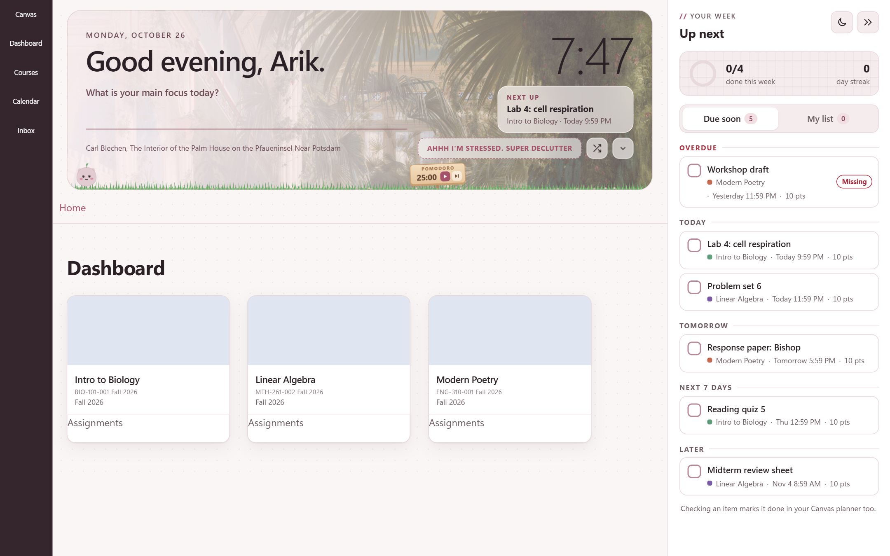
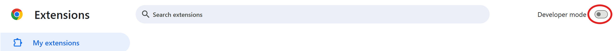
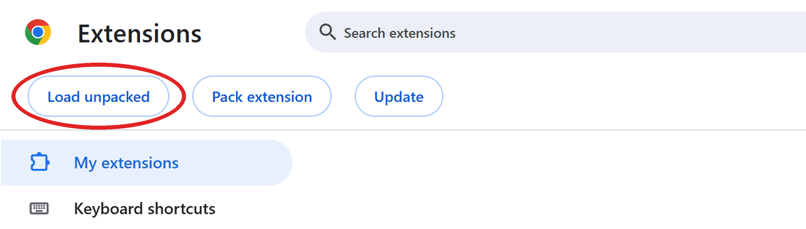
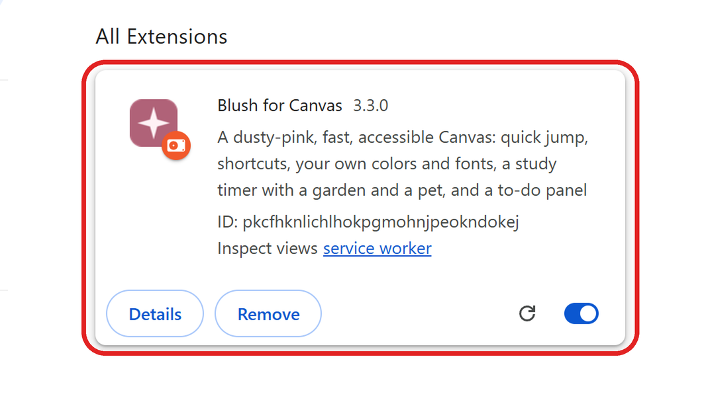
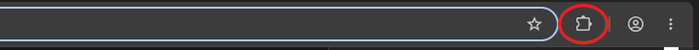
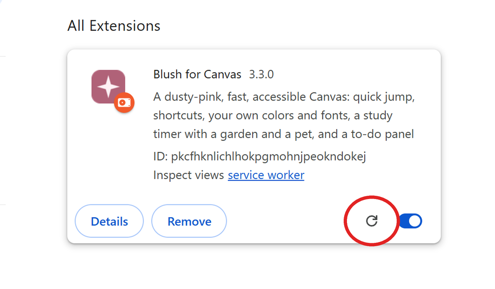

# blushing canvas

  

**Blush for Canvas** is a chrome extension that makes canvas dusty pink, faster to get around, and a little kinder to you. it adds a greeting banner, a to-do column that syncs with your canvas planner, quick jump and keyboard shortcuts, your own colors and fonts, and a study buddy that grows a garden while you focus.



## quickstart

```bash
git clone https://github.com/arikthehacker/blushing-canvas.git
```

no git? click the green **code** button on github, pick **download zip**, and unzip it somewhere you'll keep it.

**1.** open `chrome://extensions` in chrome and turn on **developer mode** in the top right corner.



**2.** click **load unpacked** and pick the `blushing-canvas` folder, the one with `manifest.json` in it.



**3.** blush for canvas shows up in your list. leave its switch on.



**4.** pin it so the settings are one click away. click the puzzle piece next to the address bar, then the pin next to blush for canvas.



**5.** open canvas and refresh the page.

expected result:

```
the dashboard gets a greeting banner and a to-do column on the right
ctrl+k on any canvas page opens quick jump
```

blush runs on any school at `*.instructure.com` by itself. if your school's canvas has its own address (like `canvas.yourschool.edu`), open it, click the blush icon, and tap **turn on blush for** your school. chrome asks you to allow that one site.

### updating

replace the files in the same folder, then click the reload arrow on the blush card.



keep the same folder. chrome treats an unpacked extension in a new folder as a different extension, so your garden, streak and settings would start over.

## using it

the [manual](MANUAL.md) goes through every feature. the keys you'll use most:

| key | what it does |
| --- | --- |
| `ctrl+k` or `/` | quick jump to any course, section, assignment or recent page |
| `t` | open or fold the to-do column |
| `p` | start or pause the study timer |
| `1` to `9` | open your 1st to 9th course |
| `g` then a letter | jump inside the course you're in, like `g` `a` for assignments |
| `?` | the full list |

## how it works

it's plain javascript with no build step and no server. chrome loads the folder as it is.

| path | job |
| --- | --- |
| `manifest.json` | permissions, and the content scripts in the order they load |
| `background.js` | the service worker: picks the daily painting, runs the pomodoro timer, caches google fonts, and turns blush on for your school's own address |
| `content/` | the content scripts, one feature per file. `settings.js` loads first and `main.js` starts everything last |
| `shared/` | `look.js` (colors and fonts) and `pets.js` (the study buddies), used by both canvas and the popup |
| `styles/` | `theme.css` recolors canvas itself. the others style blush's own parts |
| `popup/` | the settings popup from the toolbar icon |
| `fonts/` | arik hand, the handwriting font |
| `templates/` | sheets to trace when you draw your own study buddy |

**the content scripts share one scope.** chrome runs the files listed in `manifest.json` one after another in the same isolated world, so a `const` at the top of `settings.js` is visible in every file after it. that's why the order in the manifest matters, and why nothing runs until `main.js` calls `init()`.

**the to-do column paints from a cache first.** your courses and planner items are saved in `chrome.storage.local`, so the column shows up right away and refreshes from the canvas api in the background:

```js
async function swr(name, maxAgeMs, loader, onData)
{
  const cached = await store.get("local", lk(name));
  if (cached) onData(cached.v);
  if (cached && Date.now() - cached.t < maxAgeMs) return;
  try
  {
    const v = await loader();
    await store.set("local", lk(name), { t: Date.now(), v });
    onData(v);
  }
  catch (err)
  {
    if (!cached) onData(null, err);
  }
}
```

**instant navigation uses speculation rules.** chrome prerenders canvas links when you hover them. module items are skipped, since opening one can tick off a module requirement. discussions, announcements, quizzes and the inbox mark things as read when they open, so those are only prefetched and never run early.

```js
prerender: [
  {
    source: "document",
    where: { and: [{ href_matches: "/*" }, { not: { or: UNSAFE.concat(NO_PRERENDER) } }] },
    eagerness: "moderate",
  },
],
```

**dark mode reaches the parts css can't.** canvas hard-codes white boxes and blue links in a lot of places. `color-fixer.js` reads each element's real colors once and tags it with a class that `theme.css` repaints. it reads the whole batch before it writes anything, so the browser recalculates styles once per batch:

```js
// read everything first, then write, so the browser recalculates styles once per batch
dfReadTokens();
const decisions = batch.map(el => (el.isConnected ? dfDecide(el) : null));
```

**blush's own ui lives in shadow roots**, so canvas styles can't leak into it, and the colors come in through `--bl-*` custom properties set on `<html>`. picking five colors in the popup is enough, because `look.js` builds every other shade from them.

## privacy

blush has no server and no analytics. settings sync through your chrome account, and your own to-dos, streak, photos and garden stay in chrome on your computer. it talks to:

- your school's canvas, as you, to read your courses and planner and to mark things done
- the [art institute of chicago api](https://api.artic.edu/docs/) for the daily painting
- google fonts, only when you pick a font

## history

blush went through 16 versions over fall term 2026, from 1.0 to 3.2, and 3.3 added support for schools with their own canvas address. each version is one commit, dated to when it was made. [CHANGELOG.md](CHANGELOG.md) lists what changed in each.

## license

[MIT](LICENSE)
